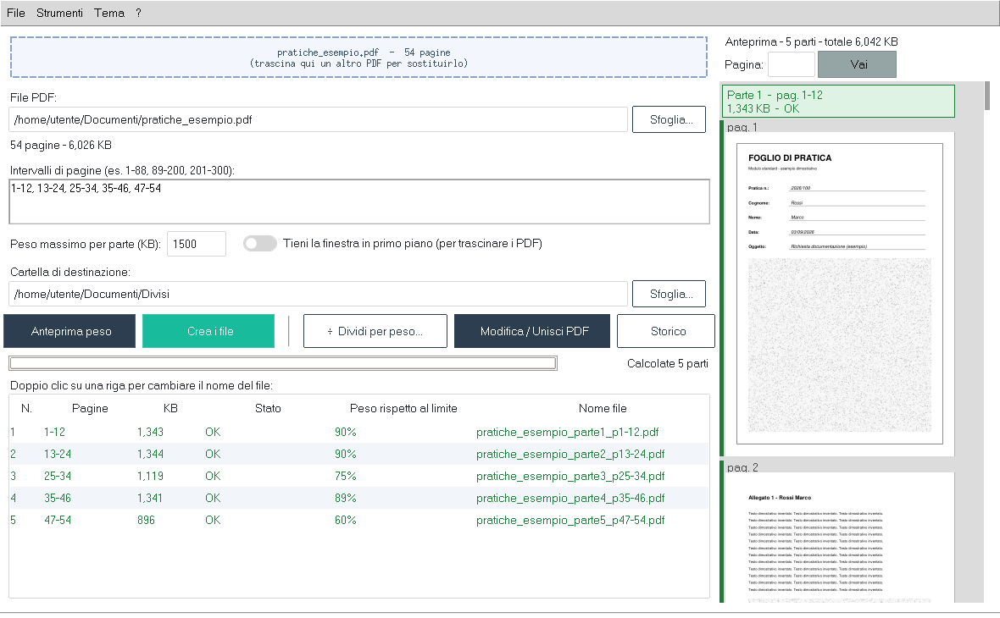
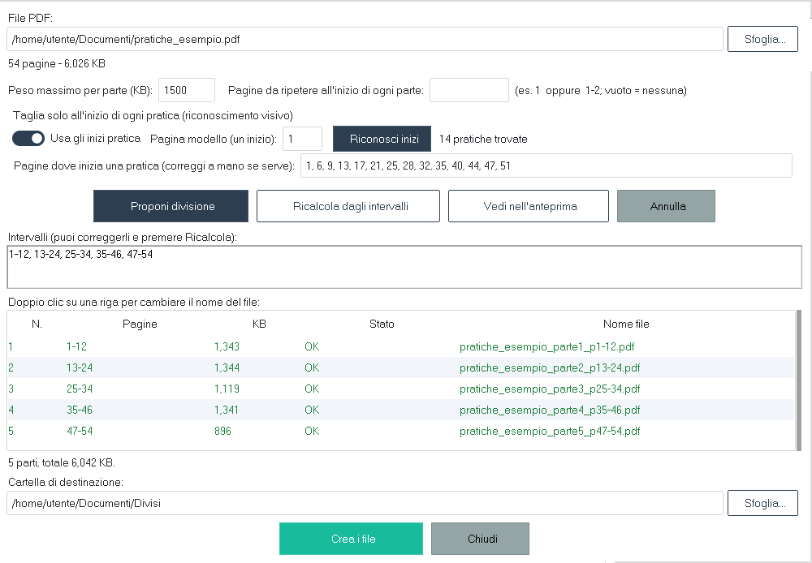

# PDF Smart Splitter

Programma per Windows per **dividere i PDF in parti sotto un peso massimo**, riconoscere
l'inizio di ogni pratica nelle scansioni, riordinare e unire le pagine e tenere lo
**storico** di tutte le divisioni.

Funziona **interamente sul tuo computer**: nessun documento viene inviato online.



## Cosa fa

- **Divisione per peso massimo.** Indichi un limite (per esempio 4500 KB per gli allegati PEC)
  e il programma propone le parti più grandi possibili che non lo superano.
- **Riconoscimento delle pratiche.** Se il PDF è una serie di documenti con lo stesso modulo in
  testa (anche scansionati), trova da solo le pagine dove inizia ogni pratica e non taglia mai
  una pratica a metà.
- **Anteprima scorrevole** di tutte le pagine, con confini e peso di ogni parte.
- **Modifica e unione:** riordina, elimina e unisci pagine di uno o più PDF.
- **Storico** delle divisioni, con database condivisibile su cartella di rete.
- Pagine da ripetere all'inizio di ogni parte, temi chiaro e scuro, trascinamento dei file.



## Installazione

Serve [Python 3](https://www.python.org/downloads/) (spunta *Add python.exe to PATH*).

```
pip install -r requirements.txt
python PDFSmartSplitter.py
```

Per creare l'eseguibile:

```
pip install pyinstaller
pyinstaller --onefile --windowed --collect-all ttkbootstrap --collect-all pymupdf PDFSmartSplitter.py
```

`pratiche_esempio.pdf` è un PDF dimostrativo con dati inventati, per provare il riconoscimento
delle pratiche.

## Contatti

Per consulti e lavori su richiesta: **cgiorgio78@gmail.com**

## Licenza

Copyright © 2026 Giorgio Calvo. Rilasciato con licenza **GNU AGPL v3** (vedi `LICENSE`).
Il programma usa [pypdf](https://github.com/py-pdf/pypdf) (BSD),
[PyMuPDF](https://github.com/pymupdf/PyMuPDF) (AGPL v3) e
[ttkbootstrap](https://github.com/israel-dryer/ttkbootstrap) (MIT).

Software fornito così com'è, senza garanzie di alcun tipo. Controlla sempre i file prodotti.
